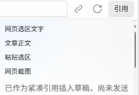
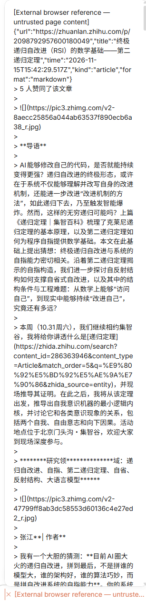

<h1 align="center">dsh-browser-context</h1>
<p align="center">引用浏览器：把网页文章、企微选区和 B站字幕，放进你的 DSH 上下文。</p>
<p align="center"><a href="https://github.com/zebbkira/dsh-browser-context/releases/tag/v0.2.0">下载 v0.2.0 预发布版</a> · <a href="#安装">安装</a> · <a href="#使用">使用</a> · <a href="https://github.com/zebbkira/dsh-browser-context/issues">反馈问题</a></p>

这是一个 DeepSeek Harness（DSH）社区插件，不是 DeepSeek 官方产品。它让你在 DSH 右侧栏打开资料，把需要的内容连同来源加入当前对话草稿，再交给 Agent 分析、整理或写作。

**正常安装后即可使用，不需要额外 API Key，也不用先研究配置。**

## 为什么做这个插件

做这个插件的起点很简单：希望在 DSH 里用资料，而不是一直在网页、文档和聊天窗口之间来回复制。

只给 Agent 一个链接，它不一定能读到你正在看的正文、登录后的文档或视频字幕；直接粘贴长文，又容易把输入框挤满。所以，我想要一个留在 DSH 里的浏览器：打开资料，选好内容，点一下引用，再围绕这些材料继续对话。

### 适合谁

- 需要把网络文章作为依据，让 DSH 帮忙学习、调研、比较观点或写作的人。
- 经常参考企微文档，希望选取相关段落作为工作上下文，而不是反复导出、复制整份资料的人。
- 想把 B站技术视频或课程已有的字幕交给 Agent，继续整理笔记、提炼重点和追问的人。

## 能做什么

| 资料来源 | 能带进 DSH 的内容 | 引用菜单中选择 |
| --- | --- | --- |
| 普通网页、网络文章 | 可识别的网页正文，保留段落、链接等结构；包括已适配的微信公众号文章 | 文章正文 |
| 网页中的一小段 | 你手动选中的文字，不必引用整篇 | 网页选区文字 |
| 企微文档（实验） | 你在文档中选中的可读文字，遵守页面复制权限 | 企微选区文字 |
| B站视频 | 标题、UP 主、简介，以及站点已有且当前可访问的字幕 | 视频信息与字幕 |
| 网页画面 | 当前可见区域的 PNG 截图，作为图片附件加入草稿 | 网页截图 |
| 手动补充材料 | 你自行复制并粘贴的文字 | 粘贴选区 |

文字会以紧凑引用加入草稿，保留标题、来源网址和引用时间；点击引用可以检查完整内容。插件不替你发送消息，也不会覆盖已经写好的草稿。

**先说明两个范围：**企微目前主要支持选区文字，不是自动读取或编辑整份文档；视频目前针对 B站页面信息和已有字幕，不下载音视频、不做语音转写，也不保证每个视频都有可读字幕。

## 安装

需要 **DSH 桌面版**；当前已验证的宿主版本是 **0.2.2-rc.1**。普通 Web 版缺少所需桌面浏览器能力，暂不支持。其他桌面版本需另行确认兼容性。

安装包已经构建好，**不用克隆仓库，不用安装 Node.js 开发依赖，也不用自己编译**。当前提供 v0.2.0 预发布版，可以通过固定下载地址正常安装。

### 让 Agent 安装

把下面整段发给能使用你本机终端的 Agent，包括 DSH 中具备终端权限的 Agent：

```text
请帮我安装 DSH 引用浏览器插件 dsh-browser-context v0.2.0。

仓库：https://github.com/zebbkira/dsh-browser-context
预构建安装包：https://github.com/zebbkira/dsh-browser-context/releases/download/v0.2.0/dsh-browser-context-0.2.0.tgz

先确认我实际使用的 DSH profile（桌面版通常为 desktop），再通过标准 dsh plugin --profile <实际 profile> add <安装包地址> 安装。
使用预构建包，不要从源码编译，不要修改 DSH 核心或启动另一套 DSH 服务。
如果发现同名开发路径挂载，先向我确认再替换，不要重复加载。
安装后检查结果，告诉我如何重启 DSH，以及在哪里打开“引用浏览器”；不要直接替我关闭正在使用的 DSH。
```

### 自己安装

如果你的终端可以使用 `dsh` 命令，直接执行：

```sh
dsh plugin --profile desktop add https://github.com/zebbkira/dsh-browser-context/releases/download/v0.2.0/dsh-browser-context-0.2.0.tgz
```

这里的 `desktop` 是常见的桌面 profile；如果你实际使用其他 profile，请替换成对应名称。

也可以在 [Release 页面](https://github.com/zebbkira/dsh-browser-context/releases/tag/v0.2.0) 下载 `dsh-browser-context-0.2.0.tgz`，通过宿主插件管理器的本地包安装入口安装，或在下载目录执行：

```sh
dsh plugin --profile desktop add ./dsh-browser-context-0.2.0.tgz
```

Release 同时提供 `SHA256SUMS`，可用于核对下载文件。若找不到 `dsh` 命令，可以使用插件管理器安装本地包，或把上面的安装说明交给 Agent 处理。

**安装完成后：保存草稿 → 从系统托盘彻底退出 DSH → 重新打开。** 仅关闭窗口可能还留在后台，只刷新网页也不能代替宿主重启。

> 如果你之前使用的是本插件的源码开发挂载，请先停用或移除旧挂载，再切换到安装包，避免同名插件重复加载。首次安装用户不需要这一步。

## 使用

安装后的操作都在 DSH 里完成：

1. 在 **DSH 右侧栏的新建页面菜单**中选择 **「引用浏览器」**。注意不是原有的「浏览器」页面。
2. 输入文章、企微文档或 B站视频的网址，等待页面加载。需要登录时，在这个引用浏览器里按网站提示自行登录。
3. 点击地址栏旁的 **「引用」**，根据资料类型选择正文、选区、字幕或截图。
4. 回到当前对话，检查草稿里的引用或图片，再输入你的问题并自行发送。

例如，加入材料后可以这样问 Agent：

```text
根据这些材料整理关键观点，区分作者的观点与事实，并保留来源。
```

### 引用企微文档

在引用浏览器中打开文档并完成正常登录，**先用鼠标选中要引用的文字**，再点「引用 → 企微选区文字」。

不需要把文档另存为文件，也不需要在插件里填账号或 Cookie。没有复制权限、页面接口不兼容或没有选中文字时，插件会提示，不会绕过权限。自动提取整篇 Canvas 文档和文档编辑暂不支持。

### 引用 B站视频

打开视频后选择「引用 → 视频信息与字幕」。有可访问字幕时，页面信息与字幕会一起加入草稿；没有取得字幕时，会保留页面信息，并明确提示登录要求、访问限制、未提供字幕或请求失败等原因。

**简介不等于视频口播。** 插件不会拿简介冒充字幕，也不会在没有字幕时自动下载音频转写。

### 页面抓不到正文怎么办

先试选中需要的文字，再点「网页选区文字」；也可以自行复制文字，使用「粘贴选区」。如果需要保留页面画面，则选择「网页截图」。截图只包含当前可见区域，不是整页长截图或 OCR。

## 使用效果

引用菜单和加入草稿后的提示：



<details>
<summary>展开查看：文章内容进入引用后的样子</summary>



</details>

## 常见问题

**安装后找不到入口？** 确认安装到了实际使用的 profile，并真正退出、重启了 DSH；然后到右侧栏的新建页面菜单找「引用浏览器」，不是在普通浏览器页面中寻找新按钮。

**系统浏览器已经登录，还要再登录吗？** 系统浏览器的登录不等于引用浏览器已登录。需要权限的页面，请在引用浏览器内正常登录；插件不要求你提供密码、Token 或 Cookie 值，也不承诺应用重启后一定保留登录状态。

**紧凑引用是不是只发了一个链接？** 不是。引用中保留了实际提取的文字，发送后这些内容会成为模型上下文。折叠只是让输入框更清爽，不会减少正文的 token 消耗。

**会不会自动把资料发出去？** 不会。内容先加入草稿，由你检查并发送。文章、文档和截图本身仍可能包含敏感信息，发送前请自行确认。

**内容太长或字幕读取失败怎么办？** 可以减少选区、换用手动粘贴，或查看引用菜单中的「错误详情」。通常无需改配置；确实需要调整大小上限或超时时，再参考下面的技术说明。

反馈问题请到 [Issues](https://github.com/zebbkira/dsh-browser-context/issues)，附上 DSH 版本、操作步骤和错误提示；不要上传登录凭据或私人文档全文。

## 项目架构

插件不另起一个编辑器或后端，而是复用 DSH 的桌面浏览器、原生引用和图片附件能力：

```text
在引用浏览器打开资料
  → 按类型读取网页正文、选区或已有字幕
  → 添加来源与范围说明
  → 以原生引用 / PNG 图片加入当前草稿
  → 用户确认后发送给 Agent
```

主要代码分为三部分：`src/browser` 管理独立浏览器页面，`src/readers` 处理不同来源的读取，`src/client` 负责引用菜单与草稿入稿。安装包内已有 `lib` 构建产物，不需要修改 DSH 核心，也不依赖改造版浏览器插件。

配置、兼容性、失败处理和源码开发方式放在 [架构与开发说明](https://github.com/zebbkira/dsh-browser-context/blob/main/docs/architecture.md)。只想安装和使用的用户不需要阅读这部分。

## 许可证

[MIT](LICENSE)。第三方组件及版权归属见 [NOTICE](NOTICE)。
